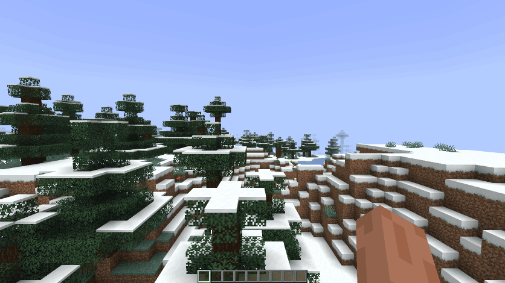
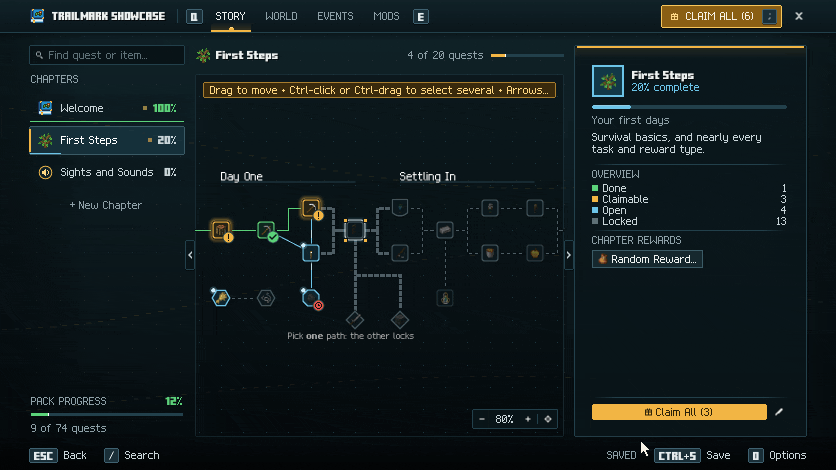
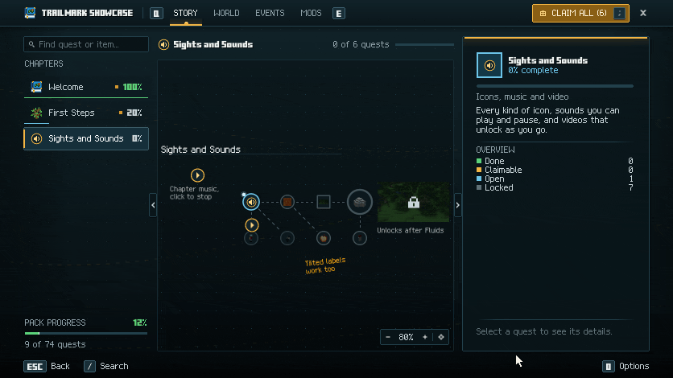
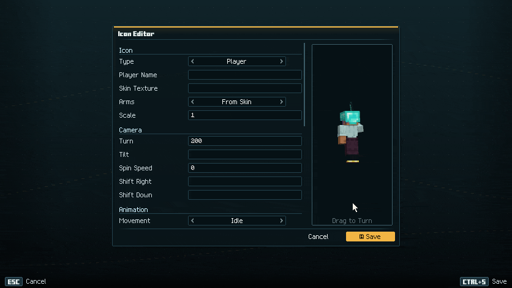
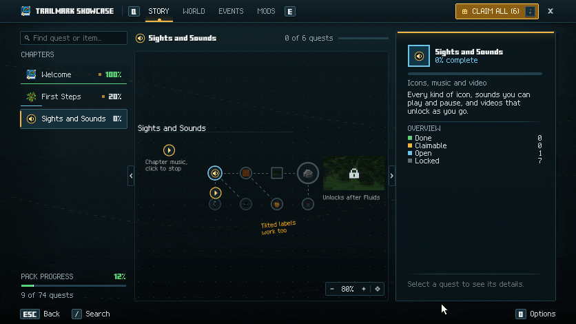
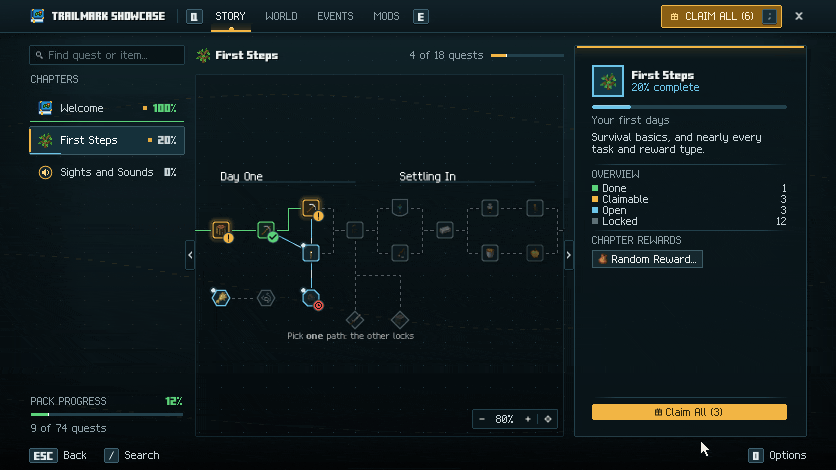
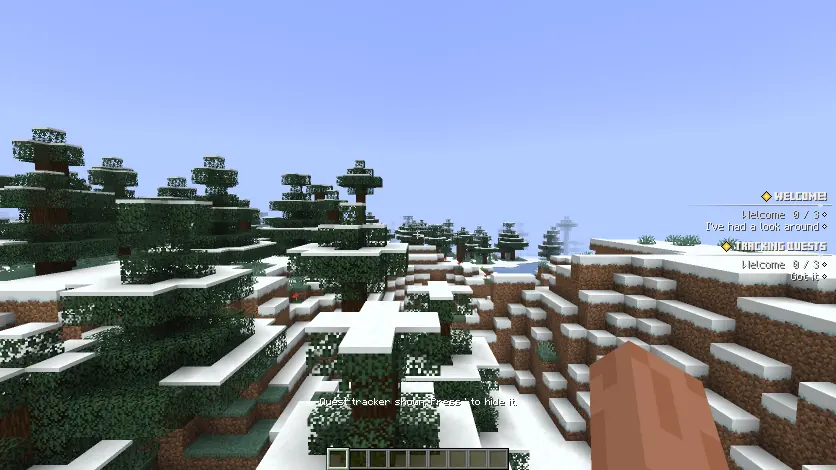

Trailmark is a quest book for modpacks. Quests are laid out on chapter maps, each quest has a page of formatted text, and the whole book is styled with CSS. You can build everything in game or in JSON files.

<a href="https://github.com/frikinjay/Trailmark/blob/main/DOCUMENTATION.md"><b>Documentation</b></a> &nbsp;·&nbsp; <a href="https://github.com/frikinjay/Trailmark/tree/main/example-pack"><b>Example&nbsp;pack</b></a> &nbsp;·&nbsp; <a href="https://github.com/frikinjay/Trailmark/tree/main/src/main/java/com/frikinjay/trailmark/api"><b>Developer&nbsp;API</b></a>

## Editing

With **Edit Quests** on, you can drag quests around the map. Their connection lines move with them.

Right-click an empty spot to add a quest, label, picture, video or sound there. Ctrl+Z undoes a change. Saving writes the chapter to JSON and keeps a backup of the previous version.

- You can also edit the JSON files directly. When a file is saved, the book reloads for everyone within a couple of seconds, and operators get a chat message listing any problems.
- `/trailmark import ftbquests` converts an FTB Quests book, including each team's progress, and lists anything it couldn't convert.
- A quest that fails to load is listed by `/trailmark problems` and left in the file.

## Mod integrations

Each integration turns on when its mod is installed. If a quest needs a mod that isn't installed, it shows as unavailable.

| Mod | What it adds |
|---|---|
| JEI, REI, EMI | R or U over an item in the book shows its recipes or uses |
| JourneyMap, Xaero's Minimap | Waypoints for places in tracked quests, removed once the quest is done |
| FTB Teams, FTB Chunks | Shared team progress; chunk-claim tasks and extra-chunk rewards |
| Accessories, Curios, Trinkets | Worn items count for tasks; rewards can go straight into slots |
| Applied Energistics 2, Refined Storage 2 | Items in a network count while a linked wireless terminal is carried |
| Backpacks and shulker boxes | Items inside count and can be handed in |
| Create, Mekanism, energy mods | Tasks for rotation speed, stress capacity, stored chemicals and stored energy near the player |
| Patchouli | Links in quest text open books, entries and pages |
| KubeJS, EasyNPC and similar | Script events and stages, or `/trailmark signal` from any NPC or command block |
| Cobblemon | Catch, defeat, evolve and trade tasks, Pokédex tasks and Pokémon rewards |
| GeckoLib | Icons can play any of a model's animations |

## Styling

The book, the HUD tracker, toasts and pop-ups are drawn from a stylesheet. Changes to the file show up while the book is open. The clip switches from the default style to a Nether style and then a vanilla-like style, both from the example pack.

Selectors cover every part of the UI, with states such as `:hover`, `:locked` and `:claimable`. Transitions, keyframes, gradients, shadows, custom fonts and `@media` rules for small screens all work. A single quest or a whole chapter can be tagged and styled on its own. Servers send their style to players on join, and players can keep their own with **Prefer My Style**.

## Quest icons

An icon can be an item, a block with its states, a structure, a mob, a player with any skin and pose, or a fluid. They're drawn with the game's own renderers, so modded blocks and mobs look the same as in the world, and GeckoLib models can play their animations.

Every icon field has an editor next to it for the icon's type, source, camera angle and animation. Dragging the preview turns the model.

## Sound and video

A quest with a sound icon gets a player on its page, with play, pause, stop and a seek bar.

Videos, chapter music and YouTube links work the same way, and media placed on the map can stay locked until a quest is done. Servers only send media when a quest that uses it is opened, at a capped rate behind game traffic, and players cache it so it downloads once.

## Search and tracking

Search looks through quest titles, tasks, rewards and tags in every chapter. Enter jumps to the first result.

Tracked quests are listed at the edge of the screen with their next tasks. <kbd>'</kbd> hides the list and shows it again.

## Feature list

| Part | Details |
|---|---|
| Tasks | 21 types: items, crafting, mining, placing, using, kills, interacting, observing, stats, advancements, locations, biomes, structures, dimensions, fluids, XP, check marks, custom signals, counters, stages and player data |
| Rewards | 12 types: items, pick-one choices, random rolls, loot tables, XP, commands, advancements, stages, counters, effects, recipes and toasts, per player or per team |
| Unlocking | All, any or a number of earlier quests; hidden until unlocked, or secret |
| Repeating | Instantly, daily, weekly or on a cooldown, against a timer, or locking out other branches |
| Seasons | Chapters that open on set dates or weekdays |
| Looks | Eight quest shapes, milestones, and connection lines per quest or per link |
| Text | Markdown, HTML, tables, call-outs, spoilers and colour codes, with items, mobs, structures and players shown inline |
| Teams | Trailmark's own parties, or FTB Teams |
| Editing | Shift-drag to link quests, box-select, nudge with the arrow keys, undo and redo, and templates you can reuse |
| Media | Sounds, videos and YouTube on quest pages or on the map, chapter music, media locked until a quest is done |
| Tracker | T in the book tracks a quest; places to visit get a compass arrow and a distance; the list moves aside for minimaps and scoreboards |

## Getting started

1. Install Trailmark on the server and on every client.
2. Copy the [example pack](https://github.com/frikinjay/Trailmark/tree/main/example-pack) into `config/trailmark/quests` and press <kbd>I</kbd> in game.
3. Edit it in game or in the files. The [documentation](https://github.com/frikinjay/Trailmark/blob/main/DOCUMENTATION.md) covers every field.
